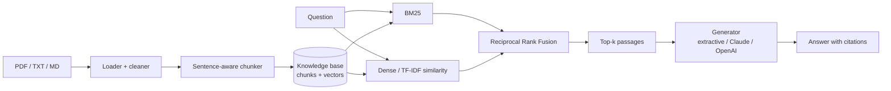

# Architecture

## Design decisions

- **Hybrid retrieval.** Scientific text mixes exact terms (acronyms, dataset names, metrics) with paraphrased
  concepts. BM25 handles the first, embeddings the second. Reciprocal Rank Fusion merges them without
  calibrating incompatible score scales.
- **Page-level provenance.** Every chunk keeps `source` and `page`, so each citation can be checked.
- **Offline by default.** TF-IDF embeddings and the extractive generator need no network or API keys;
  stronger back-ends are opt-in extras.
- **Grounded prompting.** LLM back-ends are told to use only the numbered passages and to say when the
  papers do not cover a question.
- **Idempotent ingestion.** Chunk IDs are content hashes, so re-indexing the same paper adds nothing.
